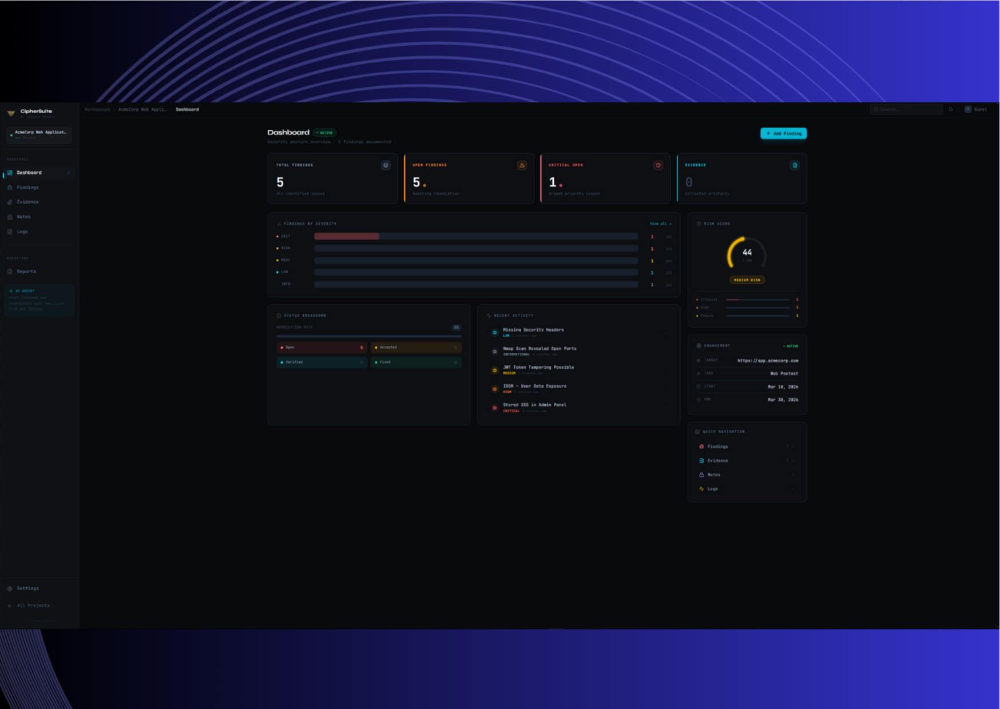
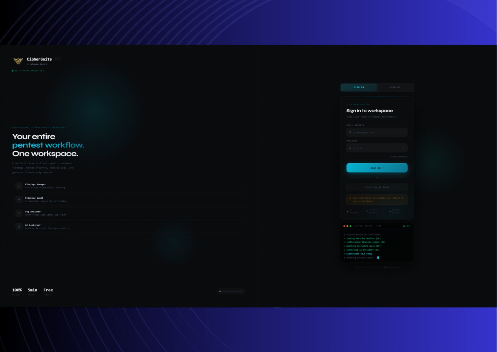

# CipherSuite
> Your entire pentest workflow. One workspace.

CipherSuite is a full-stack cybersecurity workspace for penetration testers, bug bounty hunters, SOC analysts, and security students. It replaces fragmented workflows — notes in Notion, evidence in Drive, reports in Word — with one unified, dark-themed professional environment.

---

## ⚡ Overview

From first recon to final report, everything lives in one place:

- Manage projects and security engagements
- Document and track findings with structured data
- Store and organize evidence
- Write technical notes alongside testing
- Generate professional reports with AI assistance

---

## 🧠 Core Features

### 🛡️ Project-Based Workspace
- Create isolated security engagements
- Track scope, targets, and timelines
- Risk scoring and status tracking

### 🔍 Findings Management
- Structured vulnerability documentation
- Severity classification (Critical → Informational)
- Status tracking (Open, Fixed, Verified, Accepted)
- CVSS, CWE, OWASP mapping support
- Full finding detail pages with history
- Clean technical + business impact separation

### 🧾 Evidence Vault
- Upload and manage files (images, logs, dumps)
- Bidirectional Evidence ↔ Finding linking
- Quick preview and structured storage

### 📝 Notes System
- Multi-note manager with sidebar navigation
- Markdown editor with split preview
- Tagging, pinning, and color-coded categorization
- Autosave with 1.5s debounce
- **Local-only notes mode (never synced)**
- **Self-destruct notes with auto-delete timers**
- Custom background support (stored locally)

### 🔧 Tool Import
- Parse output directly from Nmap, Nessus, and Burp Suite
- AI-powered analysis converts tool output into structured findings automatically

### 📊 Dashboard & Analytics
- Findings distribution by severity
- Risk score calculation (0–100)
- Live activity feed with audit logging
- Status and engagement overview

### 🤖 AI-Assisted Reporting
- Generate full reports from findings
- Four professional templates:
  - Executive Summary
  - Technical Report
  - Full Pentest Report
  - Bug Bounty Report
- PDF export for final deliverables
- Optimized for real-world client deliverables

### 🔐 Authentication & Security
- Firebase Authentication (Email + Google OAuth + Guest Mode)
- Project-level access isolation
- Production-grade Firestore and Storage security rules

---

## 🖥️ Screenshots

### Dashboard

### Findings Management

### Notes Workspace

### Reports Generation

### Login Interface

---

## 🏗️ Tech Stack

| Layer | Technology | Purpose |
|-------|-----------|---------|
| **Frontend** | Next.js 14, TypeScript | React App Router, SSR |
| **Styling** | Tailwind CSS + shadcn/ui | Dark war-room aesthetic |
| **Database** | Firebase Firestore | Real-time sync, offline support |
| **Auth** | Firebase Auth | Email, Google OAuth, Guest mode |
| **Storage** | Firebase Storage | Evidence files |
| **AI** | Anthropic Claude API | Report generation, tool analysis |
| **Charts** | Recharts | Analytics and dashboards |
| **Markdown** | react-markdown + remark-gfm | Notes and reports |

---

## 🚀 Current Status

**Version: v1.0** — Fully functional and deployed.

All core workflow features are live including findings management, evidence vault, AI reporting, tool import, activity logging, PDF export, and the advanced notes system.

---

## 🔮 What's Next

CipherSuite is actively evolving. The next phase focuses on expanding into new workspace types — **CTF Mode** for students and challenge tracking, and **Bug Bounty Mode** for hunters managing multiple programs. Collaborative team projects and deeper AI integration are also on the roadmap.

---

## 🧑‍💻 Author

**Alcyone Secure**

---

## 📌 Note

This project is actively evolving. Future updates will focus on deeper automation, new workspace types, and professional-grade collaboration workflows.

---

## ⭐ Support

If you find this useful, consider starring the repo.
