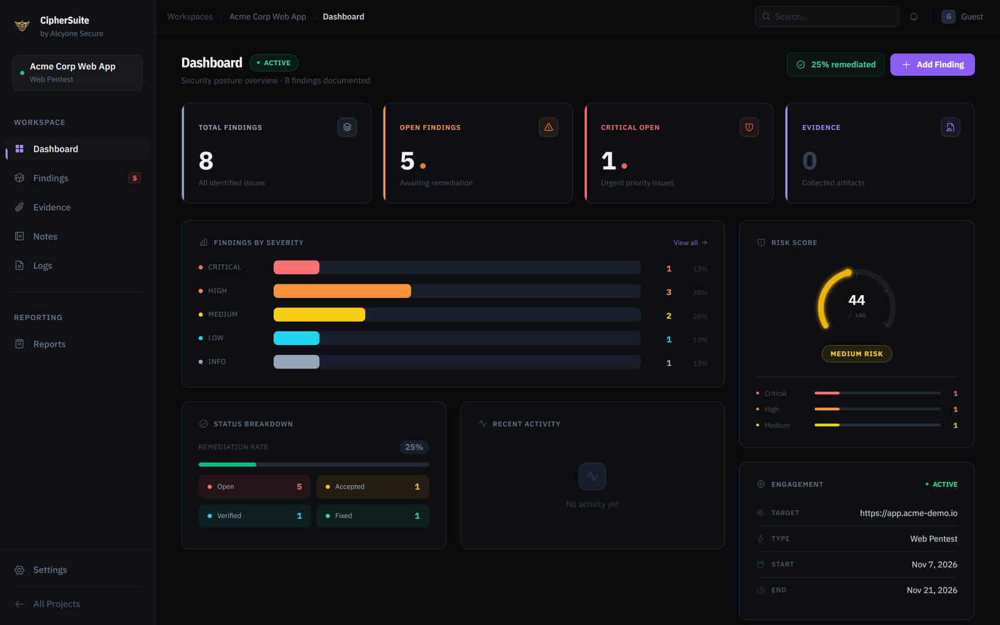
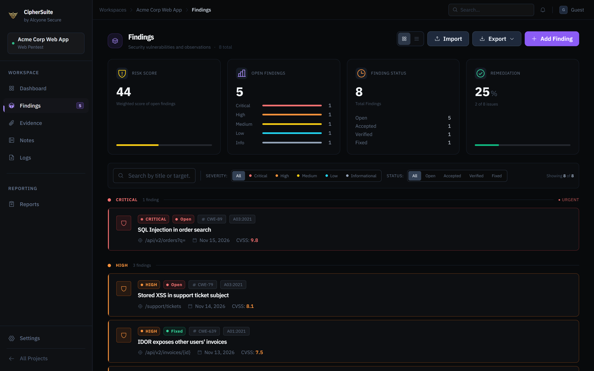
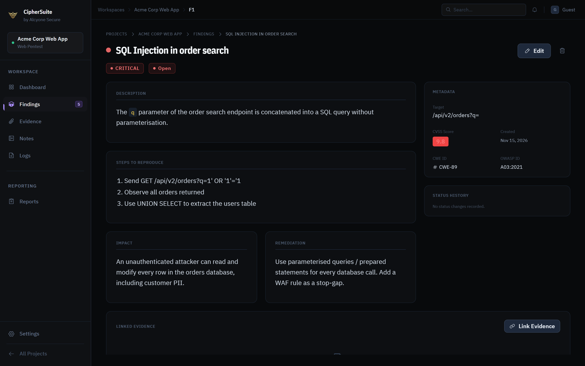
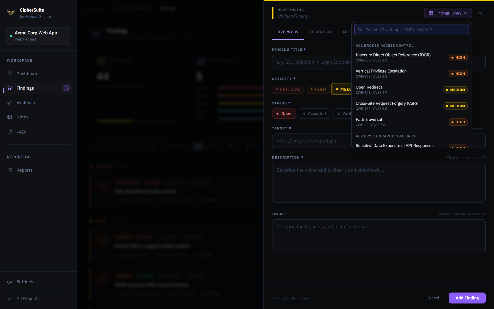
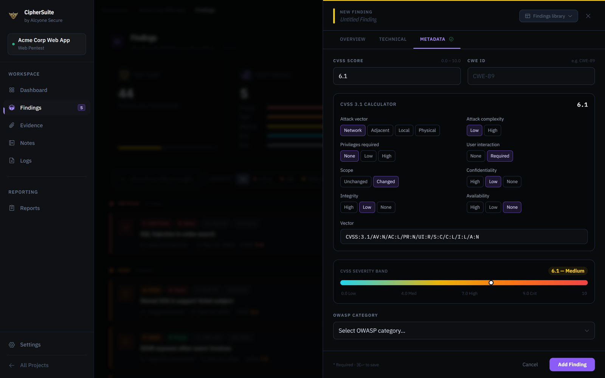
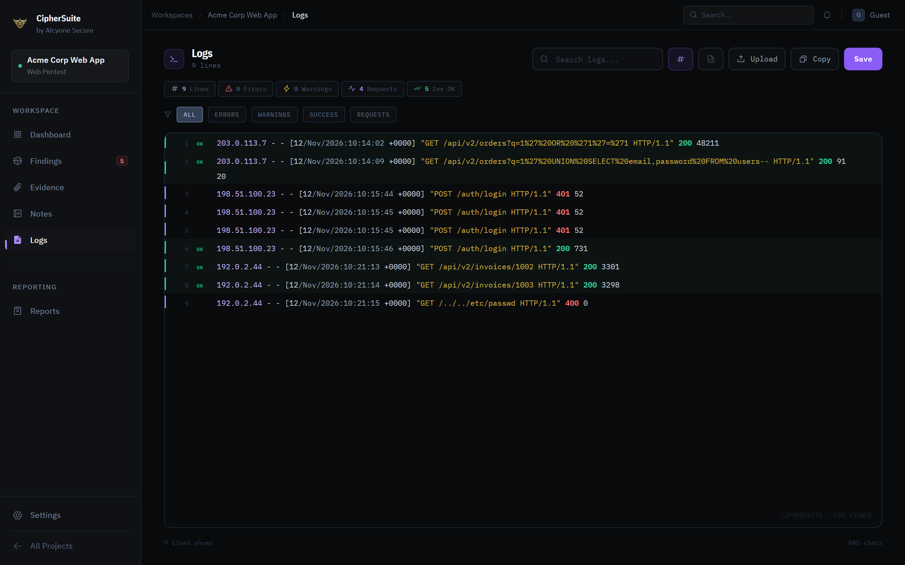
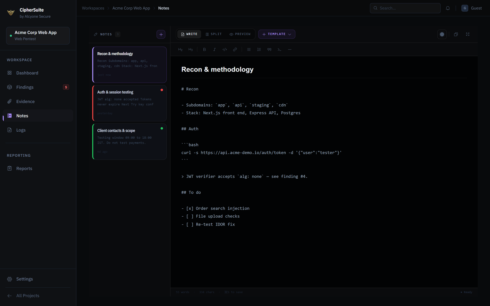
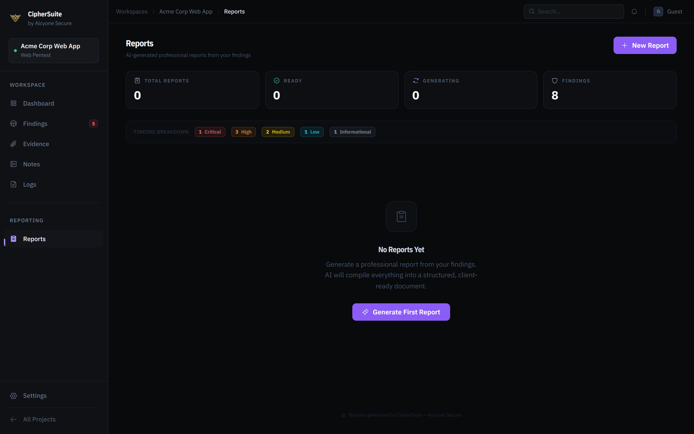
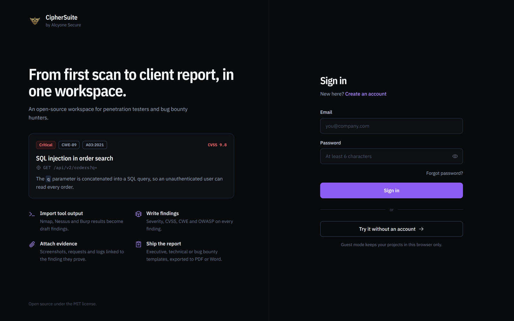

<div align="center">


# CipherSuite

**An open-source workspace for penetration testers: findings, evidence, notes, logs and client reports in one place.**

[](https://github.com/sathvik-zoldyck/ciphersuite/actions/workflows/ci.yml)
[](LICENSE)
[](https://nextjs.org)
[](https://github.com/sathvik-zoldyck/ciphersuite/stargazers)

[Quick start](#quick-start) · [Features](#features) · [Screenshots](#screenshots) · [Configuration](#configuration) · [Contributing](CONTRIBUTING.md)



</div>

## Why

Most testers keep notes in one app, screenshots in a folder, scanner output in a terminal and the report in Word, then spend the last day of every engagement stitching them together. CipherSuite keeps the whole engagement in one workspace and turns it into a client-ready report.

It runs in your browser with **no setup at all** (guest mode keeps everything in local storage), and you can add a Firebase project when you want accounts and sync.

## Quick start

```bash
git clone https://github.com/sathvik-zoldyck/ciphersuite.git
cd ciphersuite
npm install
npm run dev
```

Open http://localhost:3000 and choose **Start in guest mode**. No accounts, keys or database needed.

To add sign-in, cloud sync and the AI features, see [Configuration](#configuration).

## Features

**Findings**
- Severity, status (Open → Accepted → Verified → Fixed), target, CWE and OWASP Top 10 mapping
- **CVSS 3.1 calculator**: pick each base metric or paste a vector; scores follow the FIRST v3.1 equations
- **Findings library** of 27 reusable writeups (SQLi, XSS, IDOR, SSRF, XXE, JWT, CSRF, deserialization and more), searchable by title, CWE or OWASP ID
- **Export to CSV or JSON** for spreadsheets, Jira or Linear imports, and backups (CSV cells are protected against formula injection)

**Evidence, notes and logs**
- Evidence vault with two-way links between evidence and findings
- Markdown notes per project, plus personal notes with tags, pinning and local-only mode
- Log viewer with highlighting for IPs, methods, status codes and errors

**Tool import**
- Paste or upload **Nmap, Nessus or Burp Suite** XML; the AI turns the results into draft findings

**Reports**
- Executive, technical, full pentest and bug bounty templates
- AI drafting from your findings, exported to **PDF or Word**

**Dashboard**
- Findings by severity, weighted risk score, remediation rate and activity log

## Screenshots

| | |
|---|---|
|  **Findings** grouped by severity |  **Finding detail** |
|  **Findings library** |  **CVSS 3.1 calculator** |
|  **Log viewer** |  **Project notes** |
|  **Reports** |  **Sign in** |

## Configuration

Copy the example file and fill in what you need:

```bash
cp .env.example .env.local
```

### Accounts and sync (Firebase)

1. Create a project in the [Firebase console](https://console.firebase.google.com) and add a **Web app**. Copy its config values into the `NEXT_PUBLIC_FIREBASE_*` variables.
2. **Authentication** → Sign-in method → enable **Email/Password**.
3. Create a **Firestore** database and a **Storage** bucket.
4. Deploy the security rules, which keep every project private to its owner:
   ```bash
   npx firebase-tools login
   npx firebase-tools use <your-project-id>
   npx firebase-tools deploy --only firestore:rules,storage
   ```
5. Restart `npm run dev`. The sign-in page now offers accounts as well as guest mode.

### AI features (Gemini)

Get a key from [Google AI Studio](https://aistudio.google.com/apikey) and set `GEMINI_API_KEY` in `.env.local`. It is used only on the server; never prefix it with `NEXT_PUBLIC_`. Set a quota on the key; see [SECURITY.md](SECURITY.md).

## Deploy

CipherSuite is a standard Next.js app. On [Vercel](https://vercel.com): import the repository, add the same environment variables, and deploy. It also runs on Firebase App Hosting (`apphosting.yaml`) or any Node.js host with `npm run build && npm start`.

## Tech stack

| | |
|---|---|
| App | Next.js 15 (App Router), React 19, TypeScript |
| UI | Tailwind CSS, Radix UI, Phosphor icons, IBM Plex (self-hosted) |
| Data | Firebase Authentication, Firestore and Storage; localStorage in guest mode |
| AI | Genkit with Gemini 2.5 Flash |
| Export | jsPDF, docx, CSV and JSON |

```
src/
├── ai/flows/          AI drafting, report generation, tool-output analysis
├── app/               Pages: projects, findings, evidence, notes, logs, reports
├── components/        UI components (findings, evidence, layout, icons)
├── context/           Auth and guest-mode storage
├── hooks/             Data hooks
└── lib/               CVSS, findings library, exports, parsers, Firebase setup
```

## Development

```bash
npm run dev         # start the dev server
npm run typecheck   # TypeScript
npm test            # unit tests (Node test runner)
npm run build       # production build
```

## Security

Found a vulnerability? Please report it privately; see [SECURITY.md](SECURITY.md). It also lists what to set up when you host your own copy.

## Contributing

Writeups for the findings library, parser fixes, tests and UI improvements are all welcome. Start with [CONTRIBUTING.md](CONTRIBUTING.md).

## License

[MIT](LICENSE) © Alcyone Secure

If CipherSuite saves you time on an engagement, a ⭐ helps other testers find it.
