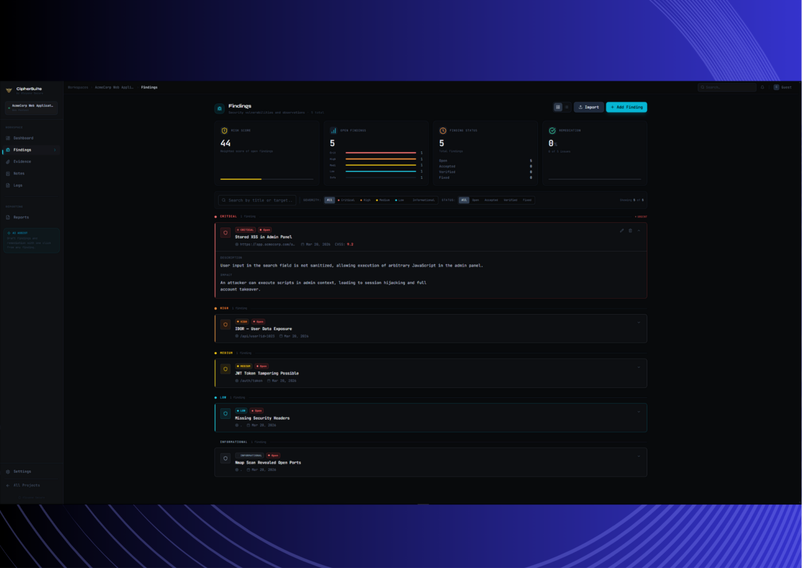
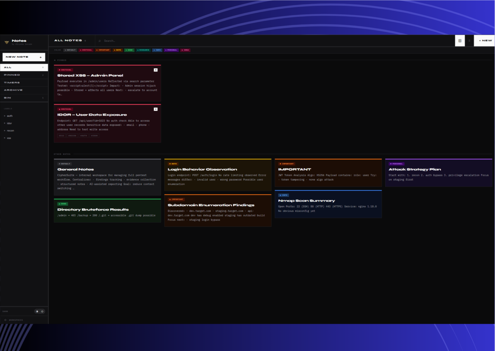
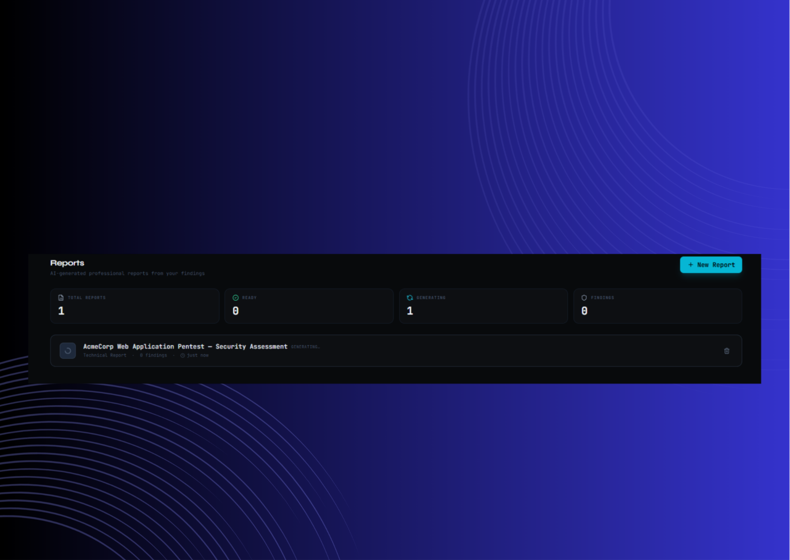

# CipherSuite

> Your entire pentest workflow. One workspace.

CipherSuite is a full-stack cybersecurity workspace designed for penetration testers, bug bounty hunters, SOC analysts, and security students.

It replaces fragmented workflows (notes, evidence, reporting) with a unified, structured, and professional environment.

---

## ⚡ Overview

CipherSuite centralizes the entire offensive security workflow:

- Manage projects and engagements
- Document findings with structured data
- Store and organize evidence
- Write technical notes alongside testing
- Generate professional reports with AI assistance

---

## 🧠 Core Features

### 🛡️ Project-Based Workspace
- Create isolated security engagements
- Track scope, targets, and timelines
- Risk scoring and status tracking

---

### 🔍 Findings Management
- Structured vulnerability documentation
- Severity classification (Critical → Informational)
- Status tracking (Open, Fixed, Verified, Accepted)
- CVSS, CWE, OWASP mapping support
- Clean technical + business impact separation

---

### 🧾 Evidence Vault
- Upload and manage files (images, logs, dumps)
- Organized per project
- Quick preview and structured storage

---

### 📝 Notes System (Advanced)
- Markdown editor with split preview
- Tagging and filtering system
- Pin important notes
- Color-coded categorization
- **Local-only notes mode (never synced)**
- **Self-destruct notes (auto-delete timers)**
- Custom background support (stored locally)

---

### 📊 Dashboard & Analytics
- Findings distribution by severity
- Risk score calculation (0–100)
- Status breakdown
- Engagement overview panel

---

### 🤖 AI-Assisted Reporting
- Generate full reports from findings
- Multiple templates:
  - Executive Summary
  - Technical Report
  - Full Pentest Report
  - Bug Bounty Report
- Optimized for real-world deliverables

---

### 🔐 Authentication & Security
- Firebase Authentication (Email + Google)
- Project-level access isolation
- Firestore security rules enforced

---

## 🖥️ Screenshots

### Dashboard

### Findings Management

### Notes Workspace

### Reports Generation

### Login Interface

---

## 🏗️ Tech Stack

- **Frontend:** Next.js 14, TypeScript
- **Styling:** Tailwind CSS + shadcn/ui
- **Animations:** Framer Motion
- **Backend:** Firebase (Firestore, Auth, Storage)
- **AI:** Anthropic Claude API
- **Charts:** Recharts
- **Markdown:** react-markdown + remark-gfm

---

## 🚧 Current Status

Version: **v1.0**

CipherSuite is fully functional with core workflow features implemented.

---

## 🔮 Upcoming Improvements

- Tool import system (Nmap, Burp, Nessus)
- Evidence ↔ Findings linking
- Dedicated finding detail pages
- PDF/DOCX report export
- Activity tracking and audit logs
- UI/UX refinements and bug fixes

---

## 🧑‍💻 Author

**Alcyone Secure**

---

## 📌 Note

This project is actively evolving.  
Future updates will focus on deeper automation, integrations, and professional-grade reporting workflows.

---

## ⭐ Support

If you find this useful, consider starring the repo.
